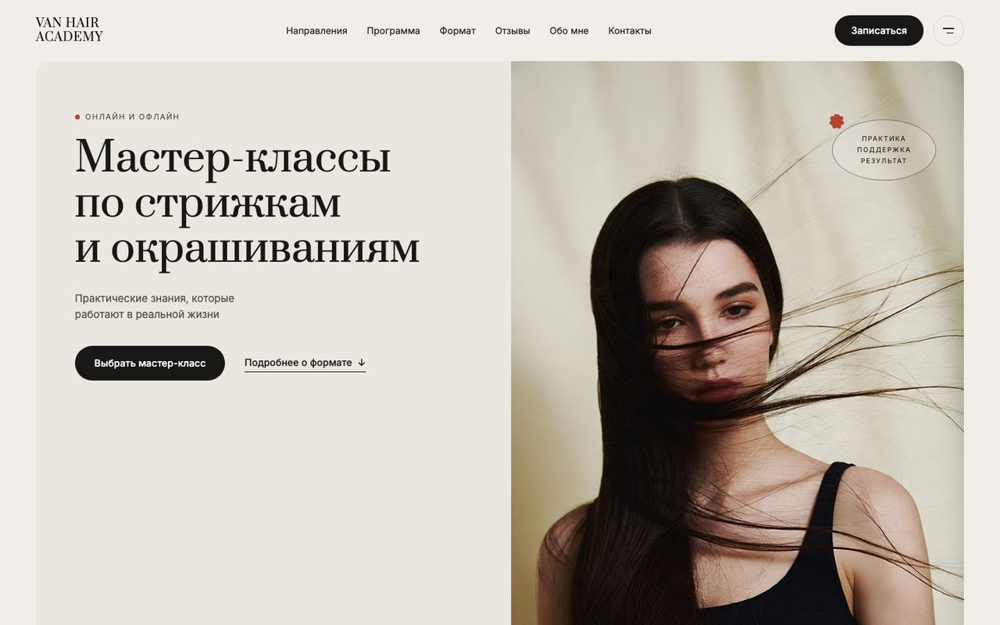
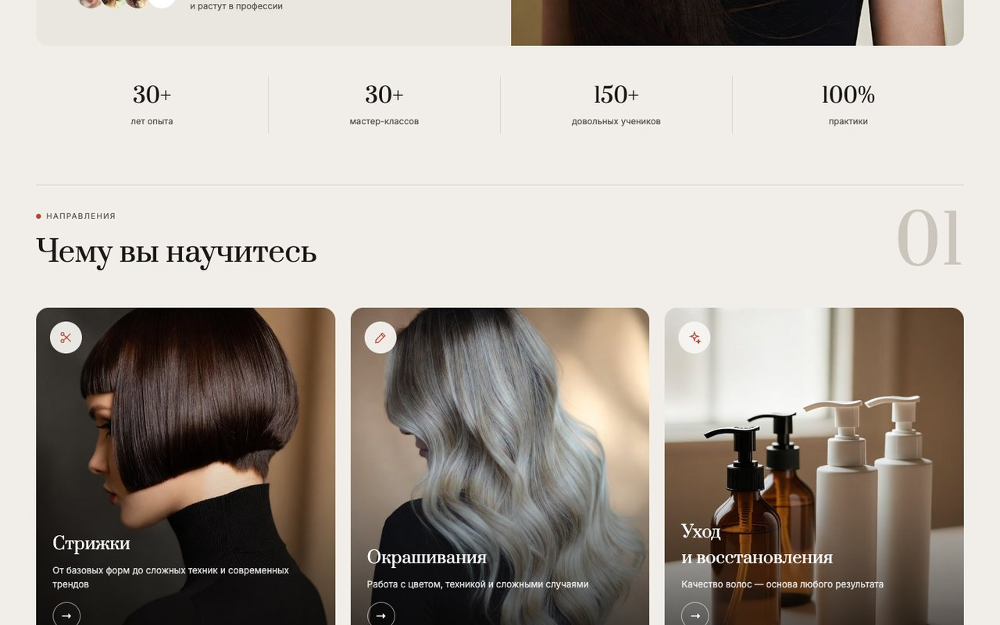
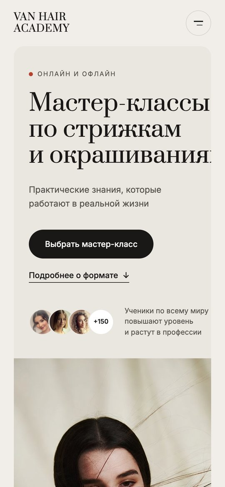
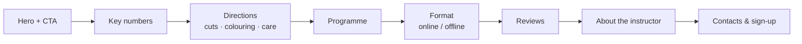

# Van Hair Academy — masterclass landing page

A landing page for a hair academy that runs **online and offline masterclasses** on haircuts and colouring. Editorial design with a serif display typeface, large photography and a calm warm palette.



| Course directions | Mobile |
|:---:|:---:|
|  |  |

## Sections



- 30+ years of experience, 30+ masterclasses, 150+ students — key numbers block
- Three directions: haircuts, colouring, hair care and restoration
- Programme, format, reviews, instructor bio and a sign-up form

## Stack

A static site — HTML, CSS (`css/academy.css`) and vanilla JavaScript (`js/main.js`) — no build step. The imagery in `img/` is generated with AI by the scripts in `genkie/` (Kie.ai / Grok Imagine).

## Run locally

```bash
python3 -m http.server 8000
# open http://localhost:8000
```
